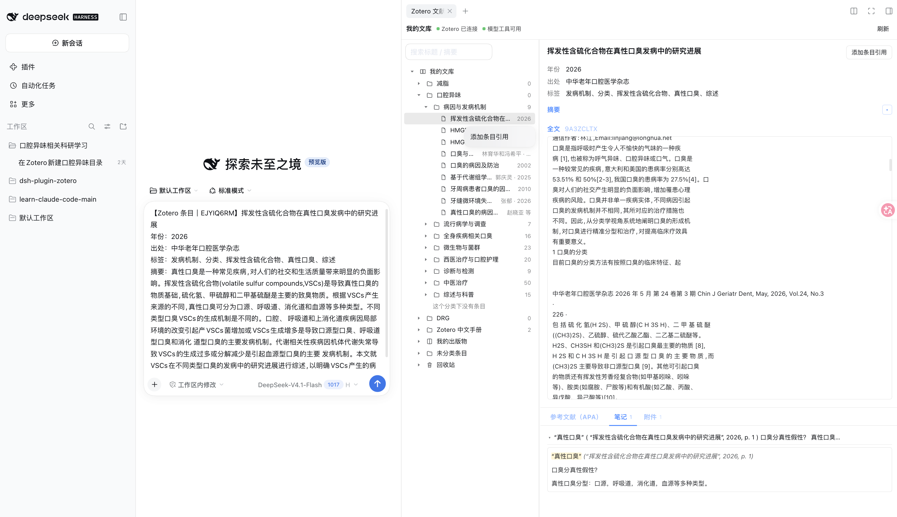
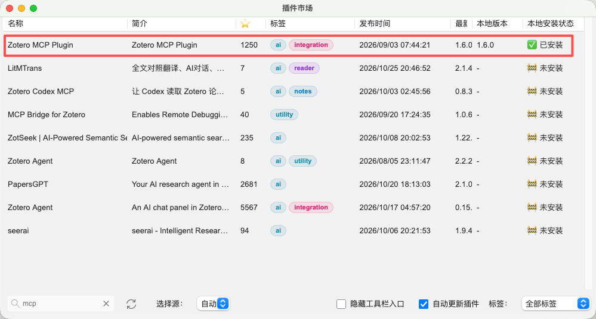
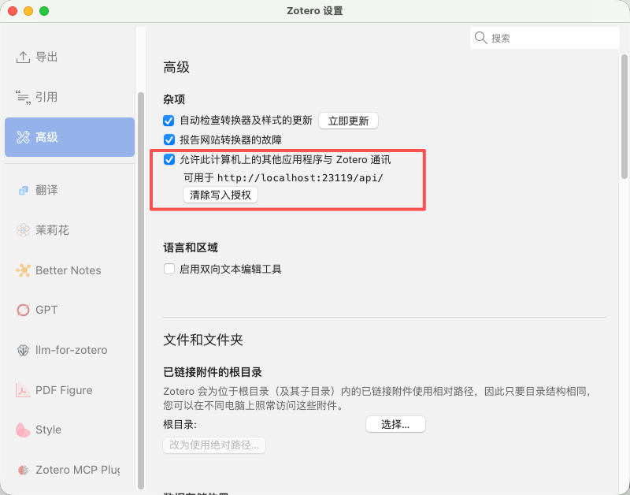

# dsh-plugin-zotero

**把 Zotero 和 DSH 连起来。**

装好这个插件，大模型就能直接查看、检索和读取你 Zotero 里的文献、笔记和 PDF 全文；你也可以在 DSH 右侧栏浏览自己的文库，把条目、摘录或整个目录一键带进对话。

不用写代码，也不用记命令。第一次使用前，只需在 Zotero 里完成两项一次性设置（装一个桥接小插件、打开通信开关），步骤见[使用前提](#使用前提)。

## 截图

[](docs/images/zotero-pane.png)

<sub>上图为 DSH 会话与右侧「Zotero 文献库」面板：上方正文区展示元数据与全文，下方分区 tab 展示参考文献、笔记与附件，点击图片可查看原图。</sub>

一句话概括它能做什么：

- **浏览与检索**：按 Zotero 分类逐级浏览文库，按标题 / 摘要搜索，查看条目的元数据、摘要、参考文献、笔记、附件与 PDF 全文。
- **带进对话**：单条目引用、全文划词摘录或整目录引用，一键写进当前会话草稿（不自动发送），模型可以接着基于它工作。
- **交给模型**：让大模型帮你找文献、读全文、整理笔记，必要时按你的要求调整分类；不想让模型改文库，可以逐个关掉写操作。
- **安全可控**：浏览面板严格只读；模型能做什么可以逐项开关。

面板分三块：顶部状态栏显示连接状态并提供刷新；左侧分类树按分类浏览与搜索；右侧详情区展示正文与「参考文献 / 笔记 / 附件」标签页。

> 面向使用者的完整说明（入口、交互、toast 与错误对照表）见 [插件使用说明](docs/插件使用说明/dsh-plugin-zotero使用说明.zh.md)。

## 安装

要求 dsh ≥ 0.2.1-rc.3（`package.json` 的 `engines.dsh` 为 `>=0.2.1-rc.3 <0.3.0-0`）。

```sh
# 从 npm（推荐）
dsh plugin --profile <profile> add dsh-plugin-zotero

# 或从插件市场安装：dsh 插件页 → 发现 → 添加索引源
#   https://awesome-dsh-plugin.com/index.json
```

包内是预构建产物（`lib/` + `client/client.js`），安装时**不运行构建脚本**，无需 `allowBuilds` 授权。本地源码开发见[方案一：本地路径安装](docs/插件发布/方案一本地路径安装.zh.md)。

## 使用前提

使用本插件前，本机 Zotero 需备好两件事：**集成 MCP 插件**与**本地 API**。

### 1. 安装 Zotero MCP 插件

在 Zotero 的插件市场搜索 `mcp`，安装列表第一行、标签为 `ai` / `integration` 的 **Zotero MCP Plugin**（即 `zotero-integrated-mcp`）。装好后无需额外配置，默认监听 `http://127.0.0.1:23120/mcp`。

[](docs/images/zotero-mcp-plugin-market.png)

<sub>上图为 Zotero 插件市场，第一行「Zotero MCP Plugin」已安装。</sub>

如果装的是**其他** MCP 插件，或它的监听地址 / 端口不是 23120，到 dsh「插件」面板展开 `dsh-plugin-zotero` → 「配置 dsh-plugin-zotero」，把 **MCP 设置 → `mcpUrl`** 改成实际端点（如 `http://127.0.0.1:<端口>/mcp`）并保存，即时生效，无需重启。字段说明见[插件页配置项](#插件页配置项)。

> 没装 MCP 插件不影响右侧面板使用，只是模型侧 `mcp__zotero__*` 工具不可用。

### 2. 开启 Zotero 本地 API

Zotero → 设置 → 高级 → 勾选 **「允许此计算机上的其他应用程序与 Zotero 通信」**（默认端口 23119，仅监听回环）。

[](docs/images/zotero-allow-communication.png)

<sub>上图为 Zotero「设置 → 高级」中开启本地 API 的开关。</sub>

验证：

```sh
curl http://127.0.0.1:23119/api/   # 期望输出：Zotero is running
```

未勾选时读端点返回 403，面板显示「Zotero 未连接」并提示启用步骤。

## 特性

- **右侧栏面板「Zotero 文献库」**：顶部状态栏（Zotero / 模型工具探活）+ 左侧分类树（按需拉取、标题摘要搜索）+ 右侧条目详情或分类概要。
- **详情区上下分区**：上方正文区展示标题、元数据、摘要与 PDF 全文；下方用 tab 切换「参考文献 / 笔记 / 附件」。两个区域之间的分隔条可拖动，正文占比默认 85% 并按会话记住；没有次级内容的条目正文独占整栏。
- **摘要默认折叠**：标题行右侧的箭头按钮展开 / 收起摘要，默认把空间留给正文与全文。
- **笔记可读**：笔记以折叠列表呈现（默认收起，点击标题展开），正文保留 Zotero 的引用块、标注高亮、表格与外链图片；Host 侧已清洗脚本与事件属性，避免注入。
- **三种插入方式**：单条目引用、全文划词摘录、整目录引用，均只写进会话草稿（不自动发送、不抢焦点），文本携带 `itemKey` / `collectionKey` 供模型接续操作。
- **面板严格只读**：不提供任何新建 / 改名 / 删除分类的按钮。
- **模型侧工具可逐个开关**：插件自持连接集成 MCP，把工具以 `mcp__zotero__*` 注册进 dsh，可在插件页按工具启用 / 禁用。

## 插件页配置项

在 dsh 顶部的「插件」面板里展开 `dsh-plugin-zotero`，点组件行上的「配置 dsh-plugin-zotero」，即可调整连接参数。表单分两组。

**API 设置**（本地 API 与面板行为）

| 字段 | 默认 | 生效点 |
|---|---|---|
| `zoteroBaseUrl` | `http://127.0.0.1:23119` | Zotero 本地 API 探活与全部请求 |
| `requestTimeoutMs` | `5000` | 单次本地 API 请求超时 |
| `fulltextMaxBytes` | `204800` | 附件全文返回上限（超出截断） |
| `defaultLimit` | `50` | 面板条目列表默认拉取条数 |

**MCP 设置**（集成 MCP 连接与工具清单）

| 字段 | 默认 | 生效点 |
|---|---|---|
| `mcpUrl` | `http://127.0.0.1:23120/mcp` | 集成 MCP 探活、工具列表与工具调用 |
| `mcpProbeTimeoutMs` | `800` | TCP 探活集成 MCP 端口超时 |
| `disabledMcpTools` | `[]` | 被停用的 MCP 工具**原始名**；模型侧据此过滤注册 |

MCP 组下方是 **「MCP 工具」** 区：现场列出集成 MCP 的全部工具（`mcp__zotero__<原始名>` + 描述），每行右侧一个开关。关掉某个工具并保存后，模型侧不再注册它（等价于从模型的工具表里摘掉）；「重新读取」可重拉清单。开启配置卡或保存后各同步一次工具注册。

保存与重置：

- 保存写入 profile 的 patch 层 `~/.dsh/profiles/<profile>/cordis.patch.yml`。
- 所有字段走 Schemastery `.volatile()`，只提交新值并唤醒引用，**无需重启**即时生效；工具开关同理（写进 `disabledMcpTools` 字段）。
- 字段旁的「已覆盖」表示该值来自 patch 层而非默认值；点「恢复默认」清掉覆盖。若该值被更高优先级的 patch 层覆盖，保存会报「被覆盖」错误。
- 「设置 → 内置插件」是只读清单，不提供编辑入口；配置入口只在「插件」面板。

实现：Host 半在 [src/index.ts](src/index.ts) 导出 `Config` schema、注入读取器（[src/zotero/config.ts](src/zotero/config.ts) 的 `setSettingsReader`）并驱动 [src/host/mcp-bridge.ts](src/host/mcp-bridge.ts)；Client 半在 [src/client/ZoteroCard.tsx](src/client/ZoteroCard.tsx) 渲染配置卡（席位 key `dsh-plugin-zotero#dsh-plugin-zotero`）。

## 架构

从使用者视角看，插件分两半，职责不重叠、互不依赖：

| 半边 | 能力 | 通道 |
|---|---|---|
| **人侧面板** | 在 DSH 右侧栏只读浏览 Zotero 文库（分类树 / 搜索 / 条目详情 / 笔记 / PDF 全文），把条目、摘录或整目录引用写进会话草稿 | 插件在宿主 web server 自注册的 `/dsh-zotero/api/*` 路由 |
| **模型侧** | 检索、精读、按需操作文库 | 插件**自持**连接本机 Zotero 集成 MCP，工具以 `mcp__zotero__*` 注册给模型 |

MCP 没起，面板照常可用；Zotero 没开，模型工具自然也不可用。

代码分布：

| 半边 | 代码位置 | 通道 |
|---|---|---|
| Host | `src/index.ts`、`src/host/`、`src/zotero/` | 把 Zotero 本地 API 包装成只读 HTTP 端点，挂在 DSH 宿主 web server 上 |
| Client | `src/client/` | 在右侧栏注册 tab、面板正文与插件页配置卡，数据与选择状态放在模块级单例 |

两条数据流：

```
人侧    浏览器面板 ──同源 fetch──▶ /dsh-zotero/api/*（Host 路由）──HTTP──▶ Zotero 本地 API（127.0.0.1:23119）
模型侧  启动 / 配置卡打开 ──sync──▶ 集成 MCP（127.0.0.1:23120）──注册──▶ dsh 工具表（mcp__zotero__*）
```

- Host 路由为 `GET /dsh-zotero/api/<action>`，action 有 `health` / `tree` / `items` / `item` / `collection-bib` / `mcp-tools`。
- Host 侧带信任栅栏：仅接受 GET，拒绝 `sec-fetch-site: cross-site`，且 `Host` 必须是回环地址（防 DNS rebinding）。
- 响应统一信封 `{ok:true,data}` / `{ok:false,error:{code,message}}`，错误码见 [src/zotero/types.ts](src/zotero/types.ts)。
- 条目详情里的笔记由 Host 侧从 `itemType: "note"` 子条目提取并清洗 HTML（剥离脚本、事件属性与冗余 `data-*`，图片限宽），Client 只负责折叠展示。
- 面板正文会被每个会话各挂一份，因此分类树 / 搜索词 / 选中项等状态放在 [src/client/paneStore.ts](src/client/paneStore.ts) 的模块级单例里，各会话看到的是同一块面板；右侧栏的展开状态与 tab 则**按会话**持久。
- 无会话时面板仍可通过右侧栏的 guide 入口（「Zotero 文献库」）打开。

## 目录结构

```
src/                      # 插件源码（主包，ESM / NodeNext / strict）
├── index.ts              # Host 半入口：Config schema、HTTP 路由、MCP 桥接装配
├── host/
│   ├── router.ts         # 只读 HTTP 路由 GET /dsh-zotero/api/<action>
│   └── mcp-bridge.ts     # 自持集成 MCP 连接 + 按开关过滤注册模型工具
├── zotero/
│   ├── client.ts         # Zotero 本地 API 客户端（只读）+ 笔记提取清洗 + 集成 MCP JSON-RPC
│   ├── config.ts         # 端点 / 超时 / 截断阈值 + 运行时设置读取器
│   └── types.ts          # Host ↔ Client 数据契约
└── client/               # Client 半（浏览器）
    ├── index.ts          # 注册右侧栏 tab、面板正文与插件页配置卡
    ├── ZoteroCard.tsx    # 插件页配置卡（API 设置 / MCP 设置 / 工具开关）
    ├── ZoteroPane.tsx    # 面板容器：状态栏 + 分类树 + 详情
    ├── CollectionTree.tsx / ItemDetail.tsx
    ├── DetailTabs.tsx    # 详情底部分区 tab（参考文献 / 笔记 / 附件）
    ├── NoteList.tsx      # 笔记折叠列表与正文渲染
    ├── styles.ts         # 分区小标题 / 展开按钮等共用样式
    ├── paneStore.ts      # 跨会话共享的面板状态
    ├── inline.ts         # 往会话草稿插入文本
    ├── compose.ts        # 插入文本模板
    ├── api.ts            # 调 Host 端点
    └── locales.ts        # zh / en 文案

client/client.js          # tsdown 产物（勿手改）
lib/                      # tsc 产物（勿手改）
cordis.patch.yml          # bundle patch 层：把本插件插入 profile 层栈
docs/                     # 使用说明、Zotero API / MCP 参考、发布与 node 学习笔记
tstest/                   # 独立测试沙盒（commonjs + tsx，与主包隔离）
plugin_helloword/         # 官方插件示例（学习用，勿放正式代码）
.trae/documents/          # 设计与实施方案（本地，未纳入版本控制）
```

主包与子项目分别有各自的 `package.json`；测试沙盒 `tstest/` 环境独立，其依赖不得引入主包。

## 环境要求

- Node + **pnpm**（主包与 `tstest/` 统一用 pnpm，勿与 npm / yarn 混用）。
- **TypeScript ^5.9**：`tsdown@0.22.0` 的 peer 依赖不支持 TypeScript 7.x。
- Zotero 桌面版已运行，且已开启本地 API（见[使用前提](#使用前提)）。
- **模型侧必需**：Zotero 已安装集成 MCP 插件（插件市场中的 **Zotero MCP Plugin** / `zotero-integrated-mcp`），监听 23120——若用其他 MCP 插件或端口不同，需在插件配置卡改 `mcpUrl`；并在 MCP 插件设置中**开启「允许写操作」**。只装插件不开写操作时，模型侧读类工具照常，但让模型新建 / 修改分类会直接报错（插件返回「写操作已禁用」）。详见[模型侧 MCP 与权限边界](#模型侧-mcp-与权限边界)。
- `dsh` CLI 可用。

## 构建

```sh
pnpm install
pnpm build            # tsc：src/ -> lib/（Host 半边）
pnpm build:client     # tsdown：src/client/ -> client/client.js（Client 半边）
pnpm typecheck:client # tsc --noEmit 校验客户端源码
```

## 本地测试启动

本地路径 link 的完整操作见 [方案一：本地路径安装](docs/插件发布/方案一本地路径安装.zh.md)，核心三步：

```sh
dsh plugin --profile demo add ./
dsh --profile demo --dump-config   # 应能看到 dsh-plugin-zotero 一行
dsh --profile demo                 # 启动
```

- **访问地址**：启动后终端会打印 URL（web server 配置 `printUrl: true`），浏览器打开 **http://127.0.0.1:3080**。该地址来自 profile 组合配置里的 web server（`host` 默认 `127.0.0.1`、`port` 默认 `3080`），不是固定端口之外另开的服务。
- **命令来源**：`dsh` 是桌面 App 自带的 CLI（如 `/usr/local/bin/dsh`）；仓库里也装了同一 CLI 的 devDependency，等价写法是 `pnpm dsh --profile demo`，两者读同一个 `~/.dsh/profiles/demo`。
- **启动前**：Host 半边与 Client 半边加载的都是构建产物（`lib/`、`client/client.js`），改完 `src/` 要先按上一节构建，再重启 dsh（见「日常迭代」）。

## 日常迭代

| 改了什么 | 要做什么 |
|---|---|
| `src/`（Host 半边） | `pnpm build` → 重启 dsh |
| `src/client/`（Client 半边） | `pnpm build:client` → 重启 dsh → 浏览器重新打开页面 |
| `cordis.patch.yml` | 重启 dsh |

客户端 bundle **没有热更新**：改完必须重启 dsh 并重新加载页面。

## 配置

### 开启 Zotero 本地 API

见[使用前提 → 开启 Zotero 本地 API](#2-开启-zotero-本地-api)。未勾选时读端点返回 403，面板显示「Zotero 未连接」并提示启用步骤。

### 模型侧 MCP 与权限边界

模型侧工具由**插件自己**桥接：[src/host/mcp-bridge.ts](src/host/mcp-bridge.ts) 直连本机 Zotero 集成 MCP（本机实测 `zotero-integrated-mcp v1.1.0`，暴露 20 个工具），按配置里的 `disabledMcpTools` 过滤后以 `mcp__zotero__*` 注册给模型。[cordis.patch.yml](cordis.patch.yml) **不再**插入 `@deepseek-ai/dsh-mcp-client` —— 它不支持按工具开关，且同 `serverName` 会与自注册工具重名冲突。

⚠️ 前提是 [Zotero 里已装好集成 MCP 插件](#1-安装-zotero-mcp-插件)（或改用其他 MCP 插件并在配置卡填对 `mcpUrl`），并且开启了「允许写操作」。插件未安装或服务未起时，模型侧工具全部不可用；插件装了但没开写操作时，读类工具正常，`create_collection` 等写工具会被插件拒绝（返回「写操作已禁用」），表现为让模型帮忙新建分类直接报错——此时到 MCP 插件设置里打开写操作并重试即可，无需重启 dsh。

⚠️ 面板只读，**但模型侧工具不是**：20 个工具中含 5 个改变文库结构的写工具（`create_collection` / `update_collection` / `delete_collection` / `add_items_to_collection` / `remove_items_from_collection`）。想收紧为纯只读，直接在插件页配置卡的「MCP 工具」里关掉它们并保存即可；面板功能不受影响。

## 相关文档

- [插件使用说明](docs/插件使用说明/dsh-plugin-zotero使用说明.zh.md) — 入口、交互、toast 与错误对照表
- [Zotero 本地 API 参考](docs/Zotero文档/Zotero本地API参考.md)
- [Zotero 集成 MCP 服务参考](docs/Zotero文档/Zotero集成MCP服务参考.md)
- [方案一：本地路径安装](docs/插件发布/方案一本地路径安装.zh.md)
- [DSH 插件开发文档](docs/DSH插件开发文档/README.zh.md)
- [开发与设计方案](.trae/documents/Zotero-DSH插件开发与设计方案.md)（本地）

## License

[MIT](LICENSE)
